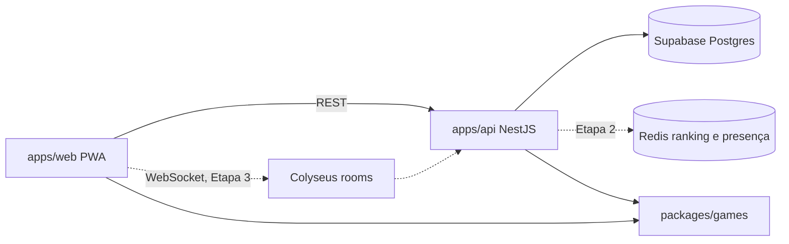

# ARCHITECTURE

Guia técnico do NoCap. Decisões de produto estão em `docs/PROJECT-BRIEF.md`; este arquivo descreve como o
código as realiza. Atualize-o no mesmo commit que mudar o comportamento descrito.

## 1. Visão

Hub de jogos para jogar com amigos (PWA). **Cada jogo é independente**: tem suas salas, regras e rankings.
Lançamento inicial: Cor e Tempo.

## 2. Monorepo

```
apps/web/         React 19 + Vite + TanStack Router/Query + Zustand + vite-plugin-pwa
apps/api/         NestJS + Drizzle ORM + postgres.js (+ Colyseus na Etapa 3)
packages/games/   lógica pura dos jogos (sem DOM, sem Node), empacotada com tsup (ESM + CJS)
packages/config/  tsconfig base
docs/             brief, roadmap, design, referências HTML, prompts
specs/            uma spec por feature
.claude/          rules, commands, skills
```

Ordem de build (Turborepo): `@nocap/games` → `@nocap/api` e `@nocap/web`. Web e api consomem
`@nocap/games/dist`; depois de editar `packages/games/src`, `pnpm dev` (watch) ou `pnpm build` atualiza.



## 3. Contrato de jogo (`packages/games`)

`GameDefinition<Settings, Round, Answer>` em `src/core/types.ts`: `id`, `meta`, `settingsSchema` (zod),
`presets`, `generateRound(seed, settings, index)` (determinístico) e `score(round, answer, settings)`
(0 a 10, 1 casa). `src/core/rng.ts` traz o PRNG com seed (mulberry32). Jogo novo = plugin em
`packages/games/src/<jogo>/` mais UI; lobby, ranking, daily, histórico e perfil não mudam.

**Anti-trapaça:** o servidor regenera as rodadas pela seed e recalcula as notas; a nota do cliente é ignorada.
Para jogos futuros com informação escondida, o contrato ganha `viewFor(state, playerId)`.

## 4. Seed e Daily

Seed string determinística. Daily: `"<game>:YYYY-MM-DD"` no fuso America/Sao_Paulo, igual para o mundo todo.

## 5. Dados (Supabase Postgres + Drizzle)

Schema em `apps/api/src/db/schema.ts`: `players`, `matches`, `match_players`, `user_game_stats`
(`head_to_head` entra na Etapa 3). **Não guardamos o alvo**, só seed e respostas (Cor: int
`h*10000+s*100+b`; Tempo: ms).

- Runtime: transaction pooler (6543) com `prepare: false` (`DATABASE_URL`).
- Migrations: session pooler (5432) via drizzle-kit (`DATABASE_URL_MIGRATIONS`).
- Retenção: detalhe das rodadas só nas últimas 200 partidas por jogo; agregados para sempre.
  Lobby, chat e eventos de sala não são salvos.

## 6. Web

- Alias `@/` para `apps/web/src`. Rotas em `src/router.tsx` (TanStack Router, code-based).
- Tokens Pop Brutal em `src/styles/tokens.css`. Ver `docs/DESIGN.md`.
- Solo roda inteiro no cliente; resultado vai para fila local (IndexedDB) e sobe quando houver rede.
- PWA: `vite-plugin-pwa` em `vite.config.ts`, `registerType: 'prompt'`.
- Variáveis `VITE_*` vêm do `.env` da raiz (`envDir: '../..'`).
- Meta: JS inicial < ~150 KB gzip, cada jogo em lazy-load.

## 7. API

Um módulo Nest por domínio, registrado em `app.module.ts`. Validação com zod. Em `apps/api`, a regra ESLint
`consistent-type-imports` fica **desligada de propósito** (quebraria `emitDecoratorMetadata`). Variáveis
vêm do `.env` da raiz, carregado em `main.ts`.

## 8. API de partidas

- `GET /games/color/daily` → `{ seed, preset }` (seed do dia em America/Sao_Paulo).
- `POST /matches` → recebe só as respostas (+ `matchId` opcional para reenvio idempotente da fila offline); regenera as rodadas pela seed, recalcula a nota, grava partida, jogador e agregados numa transação. Daily exige a seed de hoje e o modo `classic`. Responde `{ matchId, rounds:[{score}], total }`.
- `GET /players/:guestId/matches?limit&cursor` → histórico por keyset `(played_at, match_id)`, cursor opaco.
- **Unidade:** `total_score`, `score_sum` e `best` são guardados em **décimos** (500 = 50.0).
- Sem `DATABASE_URL` a API sobe; rotas com banco respondem 503.
- Pendente: aplicar a retenção (detalhe só nas últimas 200 partidas por jogo) e limitar 1 Daily por jogador por dia (com o ranking, Etapa 2).

## 9. Web: jogo da Cor

- Rotas: `/` (Hub), `/historico`, `/amigos`, `/perfil` (as três ainda "em breve") dentro de um layout com `BottomNav`; `/cor?modo=classic|flash|daily` em tela cheia, carregada sob demanda (`lazyRouteComponent`).
- `games/color/ColorGame.tsx` guarda o estado (fase, partida, resultados); cada fase é uma tela em `games/color/screens/`. Os alvos vêm de `generateColorRound(seed, ...)` do `@nocap/games`, igual ao servidor.
- Daily: a seed (`dailySeed`) é calculada no aparelho, então funciona offline. Solo: seed aleatória por partida.
- Ao fim, `submitOrQueue` tenta enviar só as respostas + `matchId` (idempotente). Sem rede ou com 5xx, a partida vai para uma fila em IndexedDB (`lib/offline-queue.ts`) e `flushQueuedMatches` reenvia ao abrir o app e no evento `online`; 4xx é descartado (reenviar nunca funcionaria).
- PWA: ícones gerados de `apps/web/public/logo.svg` (`generate-pwa-assets`), precache do shell via Workbox, fontes em cache runtime e `UpdatePrompt` (registerType `prompt`).
- `lib/sfx.ts` (Web Audio, mudo salvo no aparelho), `lib/guest.ts` (`guestId`), `lib/records.ts` (recorde local), `lib/api-client.ts` (única porta para a API).
- A barra de tempo da memorização e as contagens usam `requestAnimationFrame` (não CSS), para o tempo valer mesmo com `prefers-reduced-motion`. Com a aba em segundo plano o navegador pausa o rAF, e a rodada espera.
- JS inicial ~124 KB gzip; o jogo da Cor é um chunk à parte (~4 KB).

## 10. Eco (solo)

- Núcleo em `packages/games/src/eco`: a sequência vem da seed (`rng(seed:eco:i)`, só cresce no fim), `ecoPresets` (classic, escalada, velocidade, reverso; o Daily é o clássico com a seed do dia), `evaluateRun(seed, settings, taps)` e `minDurationMs`. Teto de 40 passos.
- API: `POST /games/eco/session` devolve seed e sessão assinada (a mesma mecânica do Tempo). `POST /matches` (`game: 'eco'`) recebe só os **toques**; o servidor os repassa contra a sequência da seed, conta os passos e recusa tempo menor que o mínimo possível, toques depois do fim e Daily repetido. Guarda `passos × 10` (como a Sobrevivência) e os toques em `answers`. Sem migration (`game` e `mode` são texto).
- **Atravessa! (spec 028, substitui o Sinal Vermelho):** núcleo puro em `packages/games/src/atravessa` (`world.ts`: biomas horta, deserto e neon com 6 linhas de transição, faixas de descanso, estrada, trilho e rio geradas da seed com corredor livre garantido; `sim.ts`: `AtravessaSim` por passos de 1/60 s, pulo de 12 ticks, fila de 2 passos, colisões, tora que carrega, pedra que afunda, escuridão com teto de velocidade; `evaluateAtravessa` refaz a partida pelos passos `[instante, direção]`). API: `POST /games/atravessa/session` (seed e sessão assinada) e `POST /matches` com `game: 'atravessa'`, `mode` `infinito`, `steps`; a nota é a maior linha atingida (guardada em décimos). Web: `games/atravessa` (Three.js carregado sob demanda: `scene.ts` câmera ortográfica diagonal fixa, luz, névoa e a escuridão como patch de shader nos materiais; `models.ts` blocos; `hop.ts` pose do pulo; `input.ts` toque e W A S D) e som em `lib/atravessa-audio.ts` (cada pulo toca a próxima nota de uma pentatônica do bioma). Só solo, só Infinito. O código e os dados do Sinal Vermelho foram removidos (14/10/2026).
- **Atravessa! polimento (spec 029):** o tráfego é por item, não por faixa (`flow.ts`: `LaneFlow` gera veículos, toras, crocodilos e tartarugas, cada um com a sua velocidade, criados em ordem com um vão calculado para um rápido nunca alcançar um lento; posição = conta do instante, sem estado). `world.ts` sorteia a **ordem dos biomas pela seed** (`biomeSequence`: transição a cada 150 linhas; grupos de três sem repetir; o 1º de cada grupo novo ≠ o último do anterior) e trechos balanceados (pesos por tamanho: trilho 1 e 2 comuns, até 5 raros; a partida pode começar em rio ou estrada). `sim.ts`: plataforma sob o herói por item, mordida do crocodilo, mergulho da tartaruga e **varridas de aviso** (parado mais de 3 s numa faixa de descanso depois da linha 20: uma linha e um "!" descem pela coluna do herói e, depois de 1,4 s, barril, bola de feno, redemoinho ou laser descem por ela; escapa quem pula de lado). Web: `vehicles.ts` (13 veículos), `props.ts` (croc, tartarugas, aviso e perigos das varridas, arcos de recorde e de marco, partículas), mortes por causa em `hop.ts`, faixa dourada na linha do recorde e arco a cada 50 linhas (100 depois da 500).
- **Atravessa! online (specs 030 e 031):** a largada é sempre na horta e há 4 linhas de recuo (`ATR_BACK_ROWS`, árvores sorteadas pela seed, coluna 0 livre). A sala (`AtravessaRoom`/`AtravessaRoomEngine`, jogo `atravessa`, 2 a 8 pessoas, sem histórico) dá a todos o mesmo mapa e a mesma largada (hora marcada pelo servidor) e **não tem colisão entre jogadores**. Cada aparelho simula o seu herói (`AtravessaSim` com `AtravessaRules`: `darkness`, `idleKillTicks`, `finishRow`, `checkpoints`, `startX`); o servidor **espelha** cada herói (`AtravessaMirror`, `room.ts`) pelas entradas com tick que o aparelho relata (`run` → `ack`) e transmite as posições em `pos` (10 Hz), então morte, distância e nota nunca saem de uma posição enviada. Modos: Infinito (rodadas, sem escuridão, parado 12 s = engolido, quem morre assiste, vale a soma dos metros) e Checkpoint (mapa de 100 a 1000 m, checkpoints de 50/75/100 m, renasce no último, timer, vence quem chega primeiro). Mundo e herói já são separados: colisão futura é o servidor decidir a ocupação das casas antes de aceitar o passo.
- **Block's (jogos de blocos, spec 021):** `POST /games/blocks/session` e `POST /matches` com `game: 'blocks'`, `mode` `classic` e `moves` (inteiros `peça x 64 + linha x 8 + coluna`). `scoreBlocksMatch` refaz a partida com `evaluateBlocks` (`BlocksGame`: as peças de cada rodada saem da seed e do tabuleiro daquele momento, com solução garantida e jogada secreta em cerca de 60% das rodadas), confere jogada por jogada, recusa partida que não terminou ou rápida demais para a sessão, e guarda a pontuação em décimos. Ranking `/rankings/blocks` (quadro `classic`), histórico e recordes pelo caminho de sempre; sem migration. O joinha, o PERFECT e a dica (`analyze`, `Coach`, `hintFor`) rodam só no aparelho e não afetam a nota. Web: `games/blocks/` (tabuleiro em SVG, arrastar com `aimAt`, efeitos em CSS só com transform/opacity) e `lib/blocks-audio.ts` (sons por Web Audio).
- **Final com câmera (spec 025):** ao acabar a partida do Block Towers, `drawFrame` afasta e desce a câmera até mostrar a torre toda (`startFinale`, `FINALE_SECONDS`), mas só se a torre for alta (`finaleMoves`). Os modos online (Corrida e Petrificar) estão registrados na spec, sem código.
- **Retomar partida (spec 024, só Block Classic):** `games/blocks/storage.ts` guarda no aparelho (`nocap-blocks-run`, uma por conta) seed, sessão, id, jogadas, elogios e dicas a cada jogada; ao abrir o modo, a ficha oferece Continuar ou Começar do zero. O tabuleiro volta refazendo as jogadas (`replay` em `BlocksPlay`), então o envio final e a conferência do servidor não mudam. Expira em 6 dias (a sessão vale 7); convidado e treino não guardam.
- **Block Towers (spec 022, modo 3 vidas, solo):** vale no ranking, histórico e perfil (`game: blocks`, modo `towers`, nota = peças empilhadas). O aparelho grava um registro de teclas (`TowersGame.log`: `passo x 16 + código`) e o servidor refaz a partida inteira em passo fixo (`towers/replay.ts`, `evaluateTowers`), recusando registro fora de ordem, partida que não terminou ou mais rápida que o relógio da sessão. A física é própria, em `packages/games/src/towers/physics.ts` (corpos rígidos de caixas orientadas, colisão por eixo separador com recorte, impulsos sequenciais com atrito e aquecimento, passo fixo, só soma, subtração, multiplicação, divisão e raiz: determinística, o servidor refaz a partida com ela). As regras estão em `towers/game.ts` (`TowersGame`: sacola de 7 peças pela seed, 3 vidas, magias boas e ruins, eventos para som e animação). Web: `games/blocks/towers/` (Canvas: cenário em camadas com céu que escurece, ilha, blocos biselados, guia de queda, mago com corações e partículas; controles por botões ou teclado) e `lib/towers-audio.ts`. O recorde também fica no aparelho (`nocap-towers-best`).
- Web: `apps/web/src/games/eco`. `EcoPlay` é o laço da partida (OBSERVE, SUA VEZ, confere cada toque); `EcoBoard` desenha 4 a 9 botões (cor + símbolo + tom, `pads.tsx`); os tons estão em `sfx.ecoPad`. A nota do Eco é uma contagem: `countUnit` (`lib/stats.ts`) decide "passos" ou "rodadas" no ranking, recordes e histórico.
- Salas do Eco (Corrida e Siga o Líder) ainda não existem.
- **Contador de tempo à vista:** `components/Countdown.tsx` (número grande, barra e, nos últimos segundos, laranja pulsando com tique). Usado no Ecooo (8 s parado, renova a cada toque), na Mesmíssima ao decorar (número acima da barra, menos no Flash) e nas fases com prazo das salas (recriar e votar). **Nunca no Já Deu?:** lá o jogador não pode ver o tempo correndo.

## 11. Estado atual

Etapa 1, passos 1 a 3 concluídos (lógica, API e UI da Cor). Próximo: PWA (passo 4), ver `docs/ROADMAP.md`.

## 12. Word's (aba Words)

- **Classic**: servidor autoritativo (`word_runs`, `WordsService`); uma jogada = um `UPDATE ... array_append ... RETURNING`. O app baixa `GET /words/wclassic/accepted` para recusar palavras inválidas na hora; cor por `scoreGuess` com `colorKey` (ç é letra própria). O fim mostra tentativas, não nota.
- **Bee e Connect**: offline, só com fases (`apps/web/src/games/words/levels/*.json`, geradas por `apps/api/scripts/words/exportar-fases.mjs` em 4 faixas), progresso no aparelho (`nocap-words-bee-v2`, `nocap-words-connect-v2`). Connect não tem vidas: conta erros, tem 1 dica e desistência com classificação.
