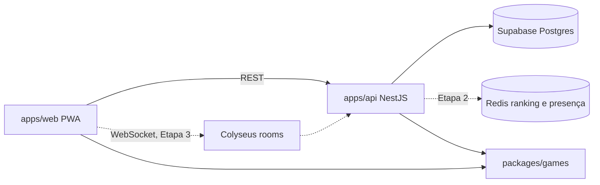

# ARCHITECTURE

Guia técnico do NoCap. Decisões de produto estão em `docs/PROJECT-BRIEF.md`; este arquivo descreve como o
código as realiza. Atualize-o no mesmo commit que mudar o comportamento descrito.

## 1. Visão

Hub de jogos para jogar com amigos (PWA). **Cada jogo é independente**: tem suas salas, regras e rankings.
Lançamento inicial: Cor e Tempo.

## 2. Monorepo

```
apps/web/         React 19 + Vite + TanStack Router/Query + Zustand + vite-plugin-pwa
apps/api/         NestJS + Drizzle ORM + postgres.js (+ Colyseus na Etapa 3)
packages/games/   lógica pura dos jogos (sem DOM, sem Node), empacotada com tsup (ESM + CJS)
packages/config/  tsconfig base
docs/             brief, roadmap, design, referências HTML, prompts
specs/            uma spec por feature
.claude/          rules, commands, skills
```

Ordem de build (Turborepo): `@nocap/games` → `@nocap/api` e `@nocap/web`. Web e api consomem
`@nocap/games/dist`; depois de editar `packages/games/src`, `pnpm dev` (watch) ou `pnpm build` atualiza.



## 3. Contrato de jogo (`packages/games`)

`GameDefinition<Settings, Round, Answer>` em `src/core/types.ts`: `id`, `meta`, `settingsSchema` (zod),
`presets`, `generateRound(seed, settings, index)` (determinístico) e `score(round, answer, settings)`
(0 a 10, 1 casa). `src/core/rng.ts` traz o PRNG com seed (mulberry32). Jogo novo = plugin em
`packages/games/src/<jogo>/` mais UI; lobby, ranking, daily, histórico e perfil não mudam.

**Anti-trapaça:** o servidor regenera as rodadas pela seed e recalcula as notas; a nota do cliente é ignorada.
Para jogos futuros com informação escondida, o contrato ganha `viewFor(state, playerId)`.

## 4. Seed e Daily

Seed string determinística. Daily: `"<game>:YYYY-MM-DD"` no fuso America/Sao_Paulo, igual para o mundo todo.

## 5. Dados (Supabase Postgres + Drizzle)

Schema em `apps/api/src/db/schema.ts`: `players`, `matches`, `match_players`, `user_game_stats`
(`head_to_head` entra na Etapa 3). **Não guardamos o alvo**, só seed e respostas (Cor: int
`h*10000+s*100+b`; Tempo: ms).

- Runtime: transaction pooler (6543) com `prepare: false` (`DATABASE_URL`).
- Migrations: session pooler (5432) via drizzle-kit (`DATABASE_URL_MIGRATIONS`).
- Retenção: detalhe das rodadas só nas últimas 200 partidas por jogo; agregados para sempre.
  Lobby, chat e eventos de sala não são salvos.

## 6. Web

- Alias `@/` para `apps/web/src`. Rotas em `src/router.tsx` (TanStack Router, code-based).
- Tokens Pop Brutal em `src/styles/tokens.css`. Ver `docs/DESIGN.md`.
- Solo roda inteiro no cliente; resultado vai para fila local (IndexedDB) e sobe quando houver rede.
- PWA: `vite-plugin-pwa` em `vite.config.ts`, `registerType: 'prompt'`.
- Variáveis `VITE_*` vêm do `.env` da raiz (`envDir: '../..'`).
- Meta: JS inicial < ~150 KB gzip, cada jogo em lazy-load.

## 7. API

Um módulo Nest por domínio, registrado em `app.module.ts`. Validação com zod. Em `apps/api`, a regra ESLint
`consistent-type-imports` fica **desligada de propósito** (quebraria `emitDecoratorMetadata`). Variáveis
vêm do `.env` da raiz, carregado em `main.ts`.

## 8. API de partidas

- `GET /games/color/daily` → `{ seed, preset }` (seed do dia em America/Sao_Paulo).
- `POST /matches` → recebe só as respostas (+ `matchId` opcional para reenvio idempotente da fila offline); regenera as rodadas pela seed, recalcula a nota, grava partida, jogador e agregados numa transação. Daily exige a seed de hoje e o modo `classic`. Responde `{ matchId, rounds:[{score}], total }`.
- `GET /players/:guestId/matches?limit&cursor` → histórico por keyset `(played_at, match_id)`, cursor opaco.
- **Unidade:** `total_score`, `score_sum` e `best` são guardados em **décimos** (500 = 50.0).
- Sem `DATABASE_URL` a API sobe; rotas com banco respondem 503.
- Pendente: aplicar a retenção (detalhe só nas últimas 200 partidas por jogo) e limitar 1 Daily por jogador por dia (com o ranking, Etapa 2).

## 9. Web: jogo da Cor

- Rotas: `/` (Hub), `/historico`, `/amigos`, `/perfil` (as três ainda "em breve") dentro de um layout com `BottomNav`; `/cor?modo=classic|flash|daily` em tela cheia, carregada sob demanda (`lazyRouteComponent`).
- `games/color/ColorGame.tsx` guarda o estado (fase, partida, resultados); cada fase é uma tela em `games/color/screens/`. Os alvos vêm de `generateColorRound(seed, ...)` do `@nocap/games`, igual ao servidor.
- Daily: a seed (`dailySeed`) é calculada no aparelho, então funciona offline. Solo: seed aleatória por partida.
- Ao fim, `submitOrQueue` tenta enviar só as respostas + `matchId` (idempotente). Sem rede ou com 5xx, a partida vai para uma fila em IndexedDB (`lib/offline-queue.ts`) e `flushQueuedMatches` reenvia ao abrir o app e no evento `online`; 4xx é descartado (reenviar nunca funcionaria).
- PWA: ícones gerados de `apps/web/public/logo.svg` (`generate-pwa-assets`), precache do shell via Workbox, fontes em cache runtime e `UpdatePrompt` (registerType `prompt`).
- `lib/sfx.ts` (Web Audio, mudo salvo no aparelho), `lib/guest.ts` (`guestId`), `lib/records.ts` (recorde local), `lib/api-client.ts` (única porta para a API).
- A barra de tempo da memorização e as contagens usam `requestAnimationFrame` (não CSS), para o tempo valer mesmo com `prefers-reduced-motion`. Com a aba em segundo plano o navegador pausa o rAF, e a rodada espera.
- JS inicial ~124 KB gzip; o jogo da Cor é um chunk à parte (~4 KB).

## 10. Eco (solo)

- Núcleo em `packages/games/src/eco`: a sequência vem da seed (`rng(seed:eco:i)`, só cresce no fim), `ecoPresets` (classic, escalada, velocidade, reverso; o Daily é o clássico com a seed do dia), `evaluateRun(seed, settings, taps)` e `minDurationMs`. Teto de 40 passos.
- API: `POST /games/eco/session` devolve seed e sessão assinada (a mesma mecânica do Tempo). `POST /matches` (`game: 'eco'`) recebe só os **toques**; o servidor os repassa contra a sequência da seed, conta os passos e recusa tempo menor que o mínimo possível, toques depois do fim e Daily repetido. Guarda `passos × 10` (como a Sobrevivência) e os toques em `answers`. Sem migration (`game` e `mode` são texto).
- **Atravessa! (spec 028, substitui o Sinal Vermelho):** núcleo puro em `packages/games/src/atravessa` (`world.ts`: biomas horta, deserto e neon com 6 linhas de transição, faixas de descanso, estrada, trilho e rio geradas da seed com corredor livre garantido; `sim.ts`: `AtravessaSim` por passos de 1/60 s, pulo de 12 ticks, fila de 2 passos, colisões, tora que carrega, pedra que afunda, escuridão com teto de velocidade; `evaluateAtravessa` refaz a partida pelos passos `[instante, direção]`). API: `POST /games/atravessa/session` (seed e sessão assinada) e `POST /matches` com `game: 'atravessa'`, `mode` `infinito`, `steps`; a nota é a maior linha atingida (guardada em décimos). Web: `games/atravessa` (Three.js carregado sob demanda: `scene.ts` câmera ortográfica diagonal fixa, luz, névoa e a escuridão como patch de shader nos materiais; `models.ts` blocos; `hop.ts` pose do pulo; `input.ts` toque e W A S D) e som em `lib/atravessa-audio.ts` (cada pulo toca a próxima nota de uma pentatônica do bioma). Só solo, só Infinito. O código e os dados do Sinal Vermelho foram removidos (14/10/2026).
- **Atravessa! polimento (spec 029):** o tráfego é por item, não por faixa (`flow.ts`: `LaneFlow` gera veículos, toras, crocodilos e tartarugas, cada um com a sua velocidade, criados em ordem com um vão calculado para um rápido nunca alcançar um lento; posição = conta do instante, sem estado). `world.ts` sorteia a **ordem dos biomas pela seed** (`biomeSequence`: transição a cada 150 linhas; grupos de três sem repetir; o 1º de cada grupo novo ≠ o último do anterior) e trechos balanceados (pesos por tamanho: trilho 1 e 2 comuns, até 5 raros; a partida pode começar em rio ou estrada). `sim.ts`: plataforma sob o herói por item, mordida do crocodilo, mergulho da tartaruga e **varridas de aviso** (parado mais de 3 s numa faixa de descanso depois da linha 20: uma linha e um "!" descem pela coluna do herói e, depois de 1,4 s, barril, bola de feno, redemoinho ou laser descem por ela; escapa quem pula de lado). Web: `vehicles.ts` (13 veículos), `props.ts` (croc, tartarugas, aviso e perigos das varridas, arcos de recorde e de marco, partículas), mortes por causa em `hop.ts`, faixa dourada na linha do recorde e arco a cada 50 linhas (100 depois da 500).
- **Atravessa! online (specs 030 e 031):** a largada é sempre na horta e há 4 linhas de recuo (`ATR_BACK_ROWS`, árvores sorteadas pela seed, coluna 0 livre). A sala (`AtravessaRoom`/`AtravessaRoomEngine`, jogo `atravessa`, 2 a 8 pessoas, sem histórico) dá a todos o mesmo mapa e a mesma largada (hora marcada pelo servidor) e **não tem colisão entre jogadores**. Cada aparelho simula o seu herói (`AtravessaSim` com `AtravessaRules`: `darkness`, `idleKillTicks`, `finishRow`, `checkpoints`, `startX`); o servidor **espelha** cada herói (`AtravessaMirror`, `room.ts`) pelas entradas com tick que o aparelho relata (`run` → `ack`) e transmite as posições em `pos` (10 Hz), então morte, distância e nota nunca saem de uma posição enviada. Modos: Infinito (rodadas, sem escuridão, parado 12 s = engolido, quem morre assiste, vale a soma dos metros) e Checkpoint (mapa de 100 a 1000 m, checkpoints de 50/75/100 m, renasce no último, timer, vence quem chega primeiro). Mundo e herói já são separados: colisão futura é o servidor decidir a ocupação das casas antes de aceitar o passo.
- **Fox Cap! e Desmorona! (spec 044):** `/fox-cap` reúne Atravessa! e Desmorona!. Motor puro em `packages/games/src/desmorona` (`DsmWorld`: 7 camadas de hexágonos que encolhem, ladrilho pisado quebra por tempo, queda para a camada de baixo, lava na última, ondas que garantem o fim em 3 a 4 min; `bots.ts`; modo online com `goOnline`/`setRemote`/`applyStep`/`markDead`/`finish`). Treino contra bots em `/fox-cap/desmorona`. Sala online (`DesmoronaRoom`/`DesmoronaRoomEngine`, jogo `desmorona`, 2 a 8, sem ranking nem histórico): cada aparelho simula só a própria raposa e refaz a arena pela seed e pelo relógio da sala; a sala fixa a hora do 1º passo em cada ladrilho (`dstep` → `dsteps`), aceita a queda (`ddead`) e decide o fim; posições em `dpos` → `pos` (10 Hz); sem colisão entre raposas (fase 3). Web: `games/desmorona` (`scene.ts` three, `controls.ts` WASD e joystick flutuante, `DesmoronaPlay`, `DesmoronaRoomPlay`).
- **Bola Maluca! (spec 046), Fase 1:** motor puro em `packages/games/src/bola` (`BolWorld`: campo de 2, 3 ou 4 gols em `field.ts`, bola com física própria em passos menores que o quadro, raposa em cápsula com pulo, pulo duplo e mortal que chuta, último toque real decide o gol, contagem de 3 s, gol de ouro, bola parada 30 s volta ao centro, entrada/saída/troca de time e `takeOver` de bot; `bots.ts`). Servidor decide tudo; sem ranking. Sala online, cena e lobby nas fases 2 a 4.
- **Aperta! reformulação de itens, geradores e grimórios (spec 043, 25/10/2026):** `UPGRADES` tem três tipos (`UpgradeKind` = `item` | `generator` | `energy`). Os 42 itens são dados puros com `ItemEffect` (5 tipos: `touchAdd`, `touchMult`, `energyMult`, `genMult`, `energyGenMult`), texto gerado por `itemText` e era pelo preço (`eraOfPrice`); `computeStats` soma os itens de forma genérica, então não há efeito escondido. A ordem de compra é a do array: `nextItemIndex` devolve o próximo, `upgradeLock` responde `order` (espera o de cima), `shelf` (longe demais, janela de 3 por `ITEM_PREVIEW_AHEAD`) ou `collapse`; `validateSave` recusa item comprado com um anterior em falta. Geradores sem teto (`autoDustCap` infinito), sem fração parada, só os de energia enchem a barra. Combo, crítico, perks e rotação saíram (combo dormente). 20 grimórios em `GRIMOIRE_CATEGORIES` (Toque, Energia, Sorte, Objetos). Save v7: `migrateFresh` zera o v6 e guarda nome, data e `storySeen`. Web: `upgrades-logic.ts` (`itemsView`, `effectLine` = total antes → depois lido do `effectiveStats` com um nível a mais, `powers`, `generatorRows`), `UpgradesPage` (Itens e Geradores), `ItemIcon` (SVG por tipo de efeito, moldura da era). `cardPreviews` (antes `gaiaPreviews`) mostra o total antes → depois em toda carta.
- **Aperta! Melhorias (spec 038, etapa 5):** `UpgradesPage` (cartões) sobre `upgrades-logic.ts` (`upgradeRows`, `buyLabel`), que só lê `UPGRADES`, `nextUpgradeCost`, `upgradeAvailable` e `effectiveStats` do motor; o ganho da próxima compra compara `effectiveStats` com um nível a mais. `controller.buy(index)` chama `buyUpgrade` e acrescenta só a trava de toque duplo (250 ms). `upgrades.css` próprio. O combo segue ligado pelo motor (`combo.enabled` = Ressonância comprada).
- **Aperta! só de lado no celular (spec 042, adendo):** `.ap` é o contêiner (`container: ap / size`, `position: fixed`), e todo `@media` de tamanho do Aperta! é `@container ap (...)` com `cq*` no lugar de vh/vw. Em tela de toque estreita em pé o `.ap` gira 90° por CSS (`aperta.css`); no Android `lib/aperta-orientation.ts` tenta travar em paisagem. `landscape.css` (último import) compacta tudo para alturas de 320 a 520 px. Quem mede posição com a tela girada usa `ap-geometry.ts` (`localRect/localPoint/localDelta`). Como `contain` do contêiner prende os `position: fixed`, modais e avisos são relativos ao jogo, não à janela. **Atualização (24/10/2026):** o giro e o tamanho da raiz em pé vêm de `lib/aperta-frame.ts` (modo `free`/`landscape`/`rotated` medido por JS, com re-medida depois de resize/orientationchange), não mais de `@media (orientation)`; a raiz carrega `data-frame` e, em pé, `width`/`height` trocados e `rotate(90deg)` inline.
- **Aperta! grimórios por raridade (spec 042, 23/10/2026):** `GRIMOIRES` tem 22 definições (14 da spec 042 mais 8 do adendo; 15 delas abrem já na primeira vida; efeitos com os números de um nível Comum); a raridade é da oferta (`PendingChoice.rarities`), não do grimório. `economy.pickInto` guarda em `RunState.build` (nível), `buildGain` (ganho acumulado que escala os efeitos: cada nível vale `RARITY_STEP` da raridade em que foi pego) e `buildRarity` (maior raridade, que define o teto `RARITY_LEVEL_CAP`); `offerableAt` impede raridade menor que a do livro e grimório no teto. O álbum guarda versões (`albumKey` = `moon:rare`). `legacy-grimoires.ts` migra o save v5. Web: `ChoiceModal` (selo de evolução), `EvolutionFx`, `GrimoiresPage` (4 espaços por astro, `albumView`). **Acesso restrito:** `ApertaAccessGuard` e `GET /me/aperta/access` (`apps/api/src/aperta/aperta-access.ts`), `lib/aperta-access.ts` no web.
- **Aperta! grimórios e álbum (spec 038, etapa 6):** `ChoiceModal` completo (cartas travadas 1,6 s pelo motor, marcar e confirmar, `modalGuarded` ignora toques nos primeiros 300 ms, `Trocar esta carta` quando `rerollsLeft > 0`, contador quando `picksLeft > 1`); `GrimoiresPage.tsx` mostra `albumView(state)` (só os liberados pelos colapsos; escondidos viram "???") e os espaços do Atlas. O sorteio é só `drawGrimoires` do motor. Testes em `grimoires.test.tsx`.
- **Aperta! objetos no espaço (spec 038, etapa 7):** regras de spawn, vida e recompensa ficam no motor (`tickObjects`, `captureObject`, `objectReward` e o novo `objectPreview`, que dá a mesma conta da captura para a etiqueta). O web só desenha e captura: `FieldObjects.tsx` (um `<button>` por objeto com `aria-label` "<Objeto>: <recompensa>. Capturar", anel pulsante, barra de vida e etiqueta; a vida e a deriva rodam em CSS `transform`/`opacity`, posição fixa por id em `objectSlot`), `SignalChip` (chip "Sinal forte xN" com barra), `controller.capture` e `tick` (usa `tickObjects`; só notifica a tela quando um objeto nasce ou some). Captura emite `capture` (aviso "<Objeto> capturado", anel e texto no lugar do objeto). Camada `.ap-field-over` não captura toque, só os botões dos objetos; `prefers-reduced-motion` deixa tudo parado. O tutorial (etapa 8) precisa impedir spawn enquanto está ativo (hoje não há bloqueio).
- **Aperta! arte e sons (spec 038, etapa 11):** `apertaSfx` (`lib/aperta-audio.ts`) liga a cada evento: `press` clack (tom sobe com o combo), objeto novo whoosh (efeito em `GameScreen` que só registra os já presentes no 1º render), `capture` ding, abrir Grimórios/escolha/passar história flip, comprar, escolher grimório, criar/continuar save e "Entendi" thunk, sem saldo e apagar save boing, fim do tutorial win. `apertaVibrate` não vibra no mudo (`isMuted` de `sfx.ts`) nem com a vibração desligada. Troca de tela: `.ap-screen-in` (só `opacity`, `backwards`). Aparelho fraco: `perf.ts` (`LOW_END`, `hardwareConcurrency <= 4`) põe `is-lite` e troca o desfoque das nebulosas e as sombras projetadas por degradês, tira uma camada de estrelas e as estrelas cadentes. `motion-css.test.ts` confere todo `*.css` da pasta: keyframes, `transition` e `will-change` só com `transform`/`opacity`, `prefers-reduced-motion` onde há animação.
- **Aperta! arte e sons das telas novas (spec 038, etapa 11b, 21/10/2026):** `apertaSfx` ganhou `page`, `ready`, `collapse`, `warp`, `chime`, `shower`, `storm`, `mission` e `star`, e `whoosh`/`ding` variam para asteroide e sonda. `cues.ts` (`cuesFor`, puro e testado) compara o estado anterior com o atual e só toca na mudança, nunca ao montar a tela: estrela pronta, início de evento, missão cumprida, troca de região e faixa Novo no espaço (o `warp` cede ao `chime` quando a troca veio de um colapso). O colapso toca `collapse` com vibração e um clarão em `opacity` (`.ap-flash`); o modal de colapso e o menu de regiões abrem com `flip`, e o passo 2 usa `page`. `polish.css` guarda a arte nova (clarão, fade da região, riscos da Chuva de meteoros e brilho da Tempestade solar sobre o campo via `EventFx`, entrada das páginas do Atlas, nó da Árvore, medalha da conquista), tudo `transform`/`opacity`, `pointer-events: none`, menos riscos em `is-lite` e parado em `prefers-reduced-motion`. `motion-css.test.ts` agora confere que todo CSS do jogo é importado por algum componente e que o `polish.css` tem reduced-motion para cada seletor animado.
- **Aperta! tutorial dinâmico (spec 038, 4.6, refeito em 22/10/2026):** o passo vive em `SaveState.tutorial` (1 a 7 ou `'done'`) e o que já surgiu em `SaveState.ui` (`unlocked`: botões do dock; `hints`: cartões do jogo livre vistos). Regras puras em `packages/games/src/aperta/tutorial.ts`: `settleTutorial` (transições por progresso: poeira da 1ª melhoria, compra, escolha aberta ou feita, gatilhos do passo 7), `unlockedButtons` (liberados + provados pelo progresso; tudo com o tutorial `'done'`), `pendingHint`/`markHintSeen`, `objectsVisible`, `migrateTutorial` (save sem `ui` = anterior ao tutorial dinâmico: quem tocou fica concluído, `validateSave` e `loadOrCreate` o chamam; `mergeSaves` une `ui`). O motor não recusa mais toque nem compra por causa do tutorial. `game-controller` roda `settleTutorial` em `commit` e no `tick`, salva o passo na hora (`saveNow`), expõe `tutorialStep(from, to)` (abrir/fechar página), `tutorialHint` e `tutorialSkip`, e só avisa conquista a partir do passo 7. Tela: `coachView(state, page, busy)` (`tutorial-logic.ts`) decide a dica só lendo save e página; `TutorialCoach` (`Tutorial.tsx`) desenha anel em `opacity`, etiqueta com seta e cartão sem véu nem bloqueio, `TutorialInline` leva o cartão da escolha do 1º grimório para dentro do `ChoiceModal`; dock, colapsos, Árvore e objetos só renderizam o que `unlockedButtons`/`objectsVisible` liberam; alvos por `data-tut`.
- **Aperta! colapso e Atlas (spec 038, etapa 9):** `collapse`/`canCollapse`/`collapseProgress` no motor (`engine.ts`; a vida nova nasce do zero com o tutorial `'done'`, a página entra a 60% e os espaços sobem nos colapsos 5, 10, 25 e 50 via `atlasSlots`) e `validateSave` confere espaços, páginas e Fragmentos (`save.test.ts` valida uma cadeia de 10 colapsos com troca de página). No web, `game-logic.ts` tem as visões puras (`atlasView`, `collapseView`, `collapseCandidates`, `needsReplacement`), `CollapseModal` faz os 2 passos (escolher a página e, com o Atlas cheio, qual sai; depois fica, sai e Fragmentos), `AtlasSection` (na página de Grimórios) mostra espaços, bônus de conjunto e o botão, `controller.collapse` salva na hora e o botão "Estrela pronta: colapso N" aparece sob o HUD, com a barra de cada requisito. Estilos em `collapse.css`.
- **Aperta! Árvore e conquistas (spec 038, etapa 10):** `achievements.ts` no motor: 31 conquistas como dados (`id`, grupo, `goal`, função de progresso), `awardAchievements` roda ao fim de `press`, `chooseGrimoire`, `captureObject`, `collapse`, `buyTreeNode` e `respecTree` e guarda o id em `save.achievements` (nunca sai, nem refazendo a árvore). Contadores novos em `stats` (`bestLevel`, `comboMaxHits`, `comboFullBest`, `satelliteStreak`, `satelliteBest`, `respecs`) e `run.comboFullSince`; `validateSave` os preenche com zero em save antigo (`.default`) e `mergeSaves` fica com o maior de cada. A árvore (`buyTreeNode`, `respecTree`, `respecFee`: devolve o gasto menos 20%, mínimo 1) já vinha da etapa 1; os nós entram em `effectiveStats`. No web, `tree-logic.ts` e `achievements-logic.ts` são as visões puras, `TreePage` (6 ramos, refazer em 2 passos) e `AchievementsPage` só mostram, `controller.buyTree`/`respec` salvam na hora e o controller emite `achievement` logo depois do evento da ação (sem aviso durante o tutorial); faixa dourada `.ap-pickup-ach` sob o aviso normal. Estilos em `tree.css` e `achievements.css`.
- **Aperta! conteúdo por colapso (spec 038, etapa 12):** o catálogo (`catalog.ts`) guarda `unlockedAtCollapse` em cada grimório, melhoria, objeto e região, e `content/index.ts` repete a tabela 5.4 para os colapsos 0 a 5 (o teste `content/content.test.ts` exige que as duas batam linha a linha). `unlockedContent` filtra tudo pelo colapso do save; `validateSave` recusa grimório, melhoria, objeto, região, evento, missão e favorito de colapso futuro e aceita save antigo (os campos novos têm valor padrão). Mecânicas: Favorito (`SaveState.favorite`, peso x2 dentro da raridade em `drawGrimoires`), eventos (`RunState.event`/`nextEventAt`: ~8 min de intervalo, 15 s; Chuva de meteoros só gera estrelas cadentes, Tempestade solar dobra a energia) e Missões da estação (`RunState.mission`, +2 Fragmentos no colapso). O sorteio dos eventos e da missão usa o tempo de jogo e o colapso, não o `rngState` das cartas. O simulador não dispara eventos. Web: `regions/regions.ts` descreve cada cenário em dados (cores do céu, 2 camadas de SVG, brilho do botão) e `regions/RegionBackdrop.tsx` só desenha; menu de regiões (`RegionMenu`, aberto pela linha de colapsos do HUD), faixa "Novo no espaço" (dispensada fica em `seenUnlocks` como `collapse:N`), chips de missão e evento (`StatusStrips.tsx`, sem cronômetro), botão Favoritar no álbum e linha extra nas cartas com o Observatório Gaia (`content-logic.ts`).
- **Aperta! tela de jogo (spec 038, etapa 4):** `GameScreen` (HUD, botão, barra de energia, dock, páginas provisórias em `GamePage`, `ChoiceModal` provisório) sobre `game-controller.ts` (liga o motor ao relógio e ao `GameStore`, sem React) e `useApertaGame.ts` (carrega o save e roda `runController`: tick de 250 ms, autosave de 30 s, `visibilitychange` pausa/retoma o relógio e salva, `pagehide` salva). Teclado: Espaço/Enter tocam, segurar repete no máximo 6/s (`createHoldLimiter`), G e M abrem páginas. Conferida em 320, 390 (celular emulado, DPR 2) e 1280 px sem rolagem lateral nem texto cortado.
- **Aperta! título, saves e história (spec 038, etapa 3):** rota `/arcade/aperta` (lazy) em `apps/web/src/games/aperta/`: `ApertaPage` (título, modal de 2 saves, história de 4 telas, tela provisória "Em construção"), lógica pura testável em `saves-flow.ts` e `story.ts`, tema espaço só em `space-tokens.css` (escopo `.ap`) e `aperta.css`. Saves atrás da interface `SaveStore` (`save-store.ts`): hoje `createLocalSaveStore` (localStorage, só dev, apagar recuperável por 7 dias); a etapa 2 troca pela API sem mexer nas telas. Convidado vê "Entre para jogar" (cartão do Arcade leva a `/entrar`).
- **Block's (jogos de blocos, spec 021):** `POST /games/blocks/session` e `POST /matches` com `game: 'blocks'`, `mode` `classic` e `moves` (inteiros `peça x 64 + linha x 8 + coluna`). `scoreBlocksMatch` refaz a partida com `evaluateBlocks` (`BlocksGame`: as peças de cada rodada saem da seed e do tabuleiro daquele momento, com solução garantida e jogada secreta em cerca de 60% das rodadas), confere jogada por jogada, recusa partida que não terminou ou rápida demais para a sessão, e guarda a pontuação em décimos. Ranking `/rankings/blocks` (quadro `classic`), histórico e recordes pelo caminho de sempre; sem migration. O joinha, o PERFECT e a dica (`analyze`, `Coach`, `hintFor`) rodam só no aparelho e não afetam a nota. Web: `games/blocks/` (tabuleiro em SVG, arrastar com `aimAt`, efeitos em CSS só com transform/opacity) e `lib/blocks-audio.ts` (sons por Web Audio).
- **Final com câmera (spec 025):** ao acabar a partida do Block Towers, `drawFrame` afasta e desce a câmera até mostrar a torre toda (`startFinale`, `FINALE_SECONDS`), mas só se a torre for alta (`finaleMoves`). Os modos online (Corrida e Petrificar) estão registrados na spec, sem código.
- **Retomar partida (spec 024, só Block Classic):** `games/blocks/storage.ts` guarda no aparelho (`nocap-blocks-run`, uma por conta) seed, sessão, id, jogadas, elogios e dicas a cada jogada; ao abrir o modo, a ficha oferece Continuar ou Começar do zero. O tabuleiro volta refazendo as jogadas (`replay` em `BlocksPlay`), então o envio final e a conferência do servidor não mudam. Expira em 6 dias (a sessão vale 7); convidado e treino não guardam.
- **Block Towers (spec 022, modo 3 vidas, solo):** vale no ranking, histórico e perfil (`game: blocks`, modo `towers`, nota = peças empilhadas). O aparelho grava um registro de teclas (`TowersGame.log`: `passo x 16 + código`) e o servidor refaz a partida inteira em passo fixo (`towers/replay.ts`, `evaluateTowers`), recusando registro fora de ordem, partida que não terminou ou mais rápida que o relógio da sessão. A física é própria, em `packages/games/src/towers/physics.ts` (corpos rígidos de caixas orientadas, colisão por eixo separador com recorte, impulsos sequenciais com atrito e aquecimento, passo fixo, só soma, subtração, multiplicação, divisão e raiz: determinística, o servidor refaz a partida com ela). As regras estão em `towers/game.ts` (`TowersGame`: sacola de 7 peças pela seed, 3 vidas, magias boas e ruins, eventos para som e animação). Web: `games/blocks/towers/` (Canvas: cenário em camadas com céu que escurece, ilha, blocos biselados, guia de queda, mago com corações e partículas; controles por botões ou teclado) e `lib/towers-audio.ts`. O recorde também fica no aparelho (`nocap-towers-best`).
- Web: `apps/web/src/games/eco`. `EcoPlay` é o laço da partida (OBSERVE, SUA VEZ, confere cada toque); `EcoBoard` desenha 4 a 9 botões (cor + símbolo + tom, `pads.tsx`); os tons estão em `sfx.ecoPad`. A nota do Eco é uma contagem: `countUnit` (`lib/stats.ts`) decide "passos" ou "rodadas" no ranking, recordes e histórico.
- Salas do Eco (Corrida e Siga o Líder) ainda não existem.
- **Contador de tempo à vista:** `components/Countdown.tsx` (número grande, barra e, nos últimos segundos, laranja pulsando com tique). Usado no Ecooo (8 s parado, renova a cada toque), na Mesmíssima ao decorar (número acima da barra, menos no Flash) e nas fases com prazo das salas (recriar e votar). **Nunca no Já Deu?:** lá o jogador não pode ver o tempo correndo.

## 11. Estado atual

Etapa 1, passos 1 a 3 concluídos (lógica, API e UI da Cor). Próximo: PWA (passo 4), ver `docs/ROADMAP.md`.

## 12. Word's (aba Words)

- **Classic**: o Daily é servidor autoritativo; os modos de 1, 2 e 4 palavras são **fases offline** (spec 036: 400/150/66 fases, `classic-levels.json`, palavras fora do Daily, progresso no aparelho). Daily: servidor autoritativo (`word_runs`, `WordsService`); uma jogada = um `UPDATE ... array_append ... RETURNING`. O app baixa `GET /words/wclassic/accepted` para recusar palavras inválidas na hora; cor por `scoreGuess` com `colorKey` (ç é letra própria). O fim mostra tentativas, não nota.
- **Progresso na conta** (spec 037): o progresso das fases (Bee, Connect e Classic) fica no aparelho e é sincronizado com a tabela `words_progress` (`/me/words-progress`), juntando sempre pelo mais adiantado: nunca se perde.
- **Bee e Connect**: offline, só com fases (`apps/web/src/games/words/levels/*.json`, geradas por `apps/api/scripts/words/exportar-fases.mjs` em 4 faixas), progresso no aparelho (`nocap-words-bee-v2`, `nocap-words-connect-v2`). Connect não tem vidas: conta erros, tem 1 dica e desistência com classificação.

## 12b. Aperta! (clicker, spec 038)

- **Etapa 1 pronta (21/10/2026): só lógica pura em `packages/games/src/aperta/`**, sem tela nem API. `catalog.ts` (dados: 40 grimórios, 10 melhorias, 5 objetos, 6 regiões, bônus de conjunto, árvore), `economy.ts` (custos `base x 1,65^nível`, passos de energia, metas de colapso; hoje `dustGoal`/`minPicks`/`lifeHoursBand`, ver o bullet do colapso infinito abaixo), `engine.ts` (`SaveState` imutável; `press`, `buyUpgrade`, `drawGrimoires`, `selectGrimoire`/`chooseGrimoire` em 2 passos com bloqueio de 1,6 s, `tickObjects`/`captureObject`, `collapse`, árvore, `effectiveStats` memoizada), `format.ts` (pt-BR), `sim.ts` (simulador por perfil que usa o próprio motor).
- **Economia reformulada (22/10/2026, branch `claude/aperta-economia-7e0f6f`, spec 038 seções 4, 5.1, 5.2, 6.2, 6.7 e 7.3):** começo do zero (o toque dá 1, a 1ª melhoria custa 25, o 1º grimório sai com ~50 de poeira ganha), objetos raros e fracos e só depois da 1ª melhoria (`objectsOpen`), melhorias com **liberação progressiva** (`UpgradeDef.unlock`: poeira ganha na vida OU nível de outra; `upgradeLock`, `upgradeUnlocks` e `upgradeAvailable` dizem o que está liberado e o que está "em breve", com a condição), preço `base x growth^nível` com trecho íngreme (`UpgradeDef.steep`), grimórios em **números** (primitivas `comboFullDust`, `objectReward`, `buyRefund`...; as primitivas em % ficaram para o Atlas e a árvore) e **melhoria x grimório sem sobreposição** (`UpgradeDef.domains` e `effectDomain`, conferidos por `catalog.test.ts`). Ganho passivo do Hubble entra em `syncClock`. `EffectiveStats` ganhou `dustPerSecond`, `combo.pointValue/fullDustAdd/fullEnergyAdd/fullMult`, `buyRefundTouches` e `objects.reward`; perdeu `fullDustPct` e `valueMult`. `validateSave` confere o marco de cada melhoria comprada, soma o ganho passivo ao teto de ritmo e segue aceitando saves antigos (poeira acima do teto novo é cortada e marcada). O simulador (`sim.ts`) lê as mesmas funções e ganhou o gancho `trace` de diagnóstico. Calibragem das vidas 1 a 5 na seção 6.7.
- O relógio vem de fora (`now` em segundos de jogo): salto maior que 5 s é aba escondida e congela objetos, boost e combo. Aleatório com `rngState` no save (determinístico). Tudo trava em 1e300.
- `pnpm --filter @nocap/games sim` imprime a tabela de horas por marco (fora do `pnpm test`).
- **Etapa 2 (saves na conta, 21/10/2026):** `packages/games/src/aperta/save.ts` (`validateSave`: formato, coerência de gastos, conteúdo de colapso futuro e ritmo possível, que corta e marca `flagged` em vez de recusar; `mergeSaves`: fica com o mais avançado, álbum e conquistas são união). Tabela `aperta_saves` (migration `0009_aperta.sql`, só cria): uma linha por (conta, espaço 1 ou 2) com o `data` inteiro, `revision` (trava otimista entre aparelhos), colunas soltas para a lista e `deleted_at` (apagar é só marcar; some de vez depois de 7 dias). Módulo `apps/api/src/aperta/`: `ApertaStore` (repositório; cada escrita é atômica no SQL: `UPDATE ... WHERE revision = base`), `ApertaService` (relógio do servidor, sempre revalida e recalcula), controlador `/me/aperta/saves` com `AuthGuard` (convidado = 401) e limite de 1 gravação por 5 s por save. Rotas: `GET /` (resumo dos 2 espaços + `recoverableUntil`), `GET/PUT/DELETE /:slot`, `POST /:slot/restore`. `PUT { data, baseRevision, overwrite? }`: `baseRevision: 0` cria; revisão velha, espaço ocupado ou volta de colapsos sem `overwrite` dão `409 { current, merged }` e nada é sobrescrito.
- **Cliente (web):** `api-save-store.ts` (`SyncedSaveStore`) guarda a cópia local por conta (`localStorage`, chave `nocap-aperta:<conta>:save:<espaço>`), grava na hora a cada mudança e sobe ao servidor a cada 30 s, ao esconder a aba, ao fechar a página, ao voltar a internet (`online`) e em `flush`, respeitando o intervalo de 5 s. Vale o save de maior revisão; cópia local só ganha se foi mexida e a conta não mudou. Quem só estava atrasado junta sozinho; vidas divergentes viram `conflict`. `game-store.ts` (`createSyncedGameStore`) liga a partida em curso a esse store (o `createLocalGameStore` ficou só como utilitário de desenvolvimento, sem uso). `SyncNotice.tsx` mostra a faixa de offline/erro/sessão e o diálogo "Este save mudou em outro aparelho" (Juntar, Usar o da conta, Usar o deste aparelho; as duas últimas em 2 passos); ao resolver, `ApertaPage` desmonta a partida antes (o salvamento de saída do jogo velho não pode passar por cima da escolha) e recarrega com o estado escolhido. A versão que perde fica em `nocap-aperta:<conta>:backup:<espaço>` neste aparelho.
- **Colapso infinito e requisitos (spec 040, etapa 14, 22/10/2026):** não existe último colapso. `economy.ts`: `dustGoal(n)` é `GOAL_BASE` (2 mi) vezes a razão de cada passo em `GOAL_SEGMENTS` (trechos calibrados pelo simulador, ver seção 10 da spec 040), com guarda de 1e300 (`MAX_NUMBER`); `MAX_COLLAPSE_COUNT` é o último colapso cuja meta ainda cabe; `minPicks(n)` 20/15/12; `lifeHoursBand` e `LIFE_*` guardam as travas de duração. `milestone.ts` tem o terceiro requisito: 6 tipos (`capture`, `combo`, `generators`, `missions`, `rares`, `comboFull`) que giram por `n mod 6`, pulam o que não existe (missões antes do colapso 4; capturas, raros e missões com os objetos desligados por Cygnus X-1) e cada um com meta crescente (`milestoneGoal`); `RunState` ganhou os contadores da vida (`captured`, `rares`, `chain`/`chainBest`, `fullBest`, `missionsDone`), que zeram no colapso, e `collapseProgress` devolve os três requisitos (`ready` exige todos). As missões da estação agora vêm em sequência (a próxima chega 5 s depois da cumprida; sorteio só entre as curtas). `validateSave`: `collapses <= MAX_COLLAPSE_COUNT`, piso de poeira total (a menor entre a meta nova e a antiga de cada colapso, para saves antigos nunca serem recusados), teto de poeira da vida preso em 1e300 e contadores novos com valor padrão 0 (`fixtures/legacy-*.json` são saves reais antigos que `legacy-saves.test.ts` abre). Sem Ascender: nada de camada 2 no código, e `collapse-infinite.test.ts` vigia isso. Web: `RequirementBars` (barra por requisito, usada no botão "Estrela pronta", no modal de colapso e no Atlas), `collapseView` devolve `requirements`. Simulador: 3 perfis (casual 30 min/dia, normal 1 a 2 h/dia, ativo 4 h/dia), `formatAverageTable`, ferramenta `calibrate.sim.ts`.
- **Cofre dos Proibidos (spec 040, etapa 15, 22/10/2026):** `forbidden.ts` guarda os 10 proibidos como dados (`effects(level)`, `bonus`, `price`, selo no nível 5); `engine.ts` tem `vaultOffers` e `collapse(state, escolha)`, `SaveState.vault` (id para nível) e `seals`; `collectSources` soma o Cofre às fontes de `effectiveStats` (o preço é o meio `price: true` do proibido, e o ramo Horizonte de Eventos da árvore reforça o bônus e corta o preço). O Atlas não existe mais: `save.ts` migra v2 para v3 (`migrateVault`). Web: `VaultPage`, `CollapseModal` e o botão do Cofre na dock (a partir do 1º colapso).
- **Árvore em grafo, automações e habilidades (spec 040, etapas 18, 19 e 21):** o web calcula o layout radial (`tree-layout.ts`) e desenha 120 nós em SVG (`TreeGraph`, arrasta e dá zoom só com `transform`; `TreePanel` é o painel do nó). No motor, `tree-skills.ts` junta os nós de Automação e Habilidades em `skillStats`, `skills.ts` tem as ações (`activateSkill`, `setAutoBuy`, `tickAutomation`, `suggestedOffer`) e `syncClock` credita o Autoclick (teto `AUTOCLICK_MAX_CPS` = 6/s, só com a aba visível). Estado por vida em `run.skills` e `run.autoBuy`, com padrões para saves antigos. `SkillBar` só aparece depois do 1º nó que dá botão.
- **Árvore de Habilidades (spec 040, etapa 17, 22/10/2026):** `tree.ts` guarda o grafo (`TREE_NODES`, pais, tier, custo por nível, `effect`) e `treeStats`/`treeSourceEffects` que o `effectiveStats` lê; `engine.ts` tem `buyNode` e `respecTree` (só com `canRespec`); `SaveState.tree` é nó para nível e a versão do save é 4 (`migrateTree`). Nó com `needs` fica fechado até `TREE_FEATURES` ligar. `balance.ts` lê o custo real (`TREE_TOTAL_COST`).
- **Sorte e Exploração (spec 040, etapa 20, 23/10/2026):** `tree-fx.ts` lê os nós em `luckStats`/`exploreStats` (entram em `EffectiveStats.luck`/`.explore`); `engine.ts` aplica no sorteio (`drawGrimoires`, `ensureRarity`), em `openChoice` (pity, Garantia, Fortuna, Destino), nos eventos (`tickEvents`, `eventDuration`) e no Radar (`tickObjectsCore`); os lendários vêm de `LEGENDARY_OBJECTS` em `catalog.ts`. `starmap.ts` monta o Mapa estelar.
- **Cintilas, fontes e conquistas ampliadas (spec 040, etapa 16, 22/10/2026):** os Fragmentos saíram; `SaveState.sparks = { legacy, spent }` e o saldo é calculado por `sparks.ts` (`sparkSources`: conquistas, álbum, capturas raras, colapsos, poeira total, eventos vistos e `stats.forbiddenBest`; `sparksTotal` = `legacy` + fontes; `sparksAvailable` = total - gasto), então a migração dos Fragmentos é 1:1 em `legacy` (`migrateSparks` no `validateSave`) e o servidor refaz a mesma conta. `achievements.ts` guarda 159 conquistas como dados (`reward` de 1, 2, 3 ou 5; escondidas 3) em 16 famílias; `needs` + `FEATURES` seguram as 32 que dependem de conteúdo ainda inexistente. `SaveStats` ganhou os contadores que as alimentam (atualizados em `press`, `captureObject`, `buyUpgrade`, `chooseGrimoire`, `rerollGrimoire`, `openChoice` e `tickObjects` para o 1º evento). `balance.ts` e `tree-targets.ts` calculam T, F e R25 e o `balance.test.ts` exige `F >= 0,80 T` e `F + R25 >= 1,10 T`. Web: `game-controller` emite o evento `sparks` (aviso `.ap-pickup-sparks`), `TreePage` mostra o saldo e "De onde vêm as Cintilas", `AchievementsPage` (filtros por família, busca, estado, recompensa, "em breve") sobre `achievements-logic.ts`.
- **Diferenças da spec 10.1 (decididas na implementação):** sem `aperta_save_history`, `aperta_settings`, `active_device`/`active_until` nem rota `takeover`; o conflito é resolvido pela `revision`, sem "reservar" o save por aparelho. Se o Lucas quiser o histórico de 5 revisões ou o aviso "aberto em outro aparelho", é migration nova.

## 13. Histórico removido (19/10/2026)

A aba e a tela de Histórico, `GET /me/matches`, `GET /me/matches/:id/room` e a "atividade recente" do perfil de amigo foram removidas. As tabelas `matches`/`match_players` continuam, mas só como fonte de Ranking, recordes e Daily (as respostas de cada partida não são mais gravadas: `answers` fica nulo). O app mostra só rótulos de jogo/modo em `apps/web/src/lib/labels.ts`.
