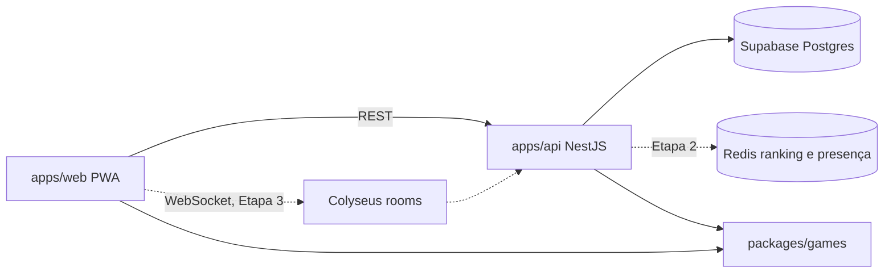

# ARCHITECTURE

Guia técnico do NoCap. Decisões de produto estão em `docs/PROJECT-BRIEF.md`; este arquivo descreve como o
código as realiza. Atualize-o no mesmo commit que mudar o comportamento descrito.

## 1. Visão

Hub de jogos para jogar com amigos (PWA). **Cada jogo é independente**: tem suas salas, regras e rankings.
Lançamento inicial: Cor e Tempo.

## 2. Monorepo

```
apps/web/         React 19 + Vite + TanStack Router/Query + Zustand + vite-plugin-pwa
apps/api/         NestJS + Drizzle ORM + postgres.js (+ Colyseus na Etapa 3)
packages/games/   lógica pura dos jogos (sem DOM, sem Node), empacotada com tsup (ESM + CJS)
packages/config/  tsconfig base
docs/             brief, roadmap, design, referências HTML, prompts
specs/            uma spec por feature
.claude/          rules, commands, skills
```

Ordem de build (Turborepo): `@nocap/games` → `@nocap/api` e `@nocap/web`. Web e api consomem
`@nocap/games/dist`; depois de editar `packages/games/src`, `pnpm dev` (watch) ou `pnpm build` atualiza.



## 3. Contrato de jogo (`packages/games`)

`GameDefinition<Settings, Round, Answer>` em `src/core/types.ts`: `id`, `meta`, `settingsSchema` (zod),
`presets`, `generateRound(seed, settings, index)` (determinístico) e `score(round, answer, settings)`
(0 a 10, 1 casa). `src/core/rng.ts` traz o PRNG com seed (mulberry32). Jogo novo = plugin em
`packages/games/src/<jogo>/` mais UI; lobby, ranking, daily, histórico e perfil não mudam.

**Anti-trapaça:** o servidor regenera as rodadas pela seed e recalcula as notas; a nota do cliente é ignorada.
Para jogos futuros com informação escondida, o contrato ganha `viewFor(state, playerId)`.

## 4. Seed e Daily

Seed string determinística. Daily: `"<game>:YYYY-MM-DD"` no fuso America/Sao_Paulo, igual para o mundo todo.

## 5. Dados (Supabase Postgres + Drizzle)

Schema em `apps/api/src/db/schema.ts`: `players`, `matches`, `match_players`, `user_game_stats`
(`head_to_head` entra na Etapa 3). **Não guardamos o alvo**, só seed e respostas (Cor: int
`h*10000+s*100+b`; Tempo: ms).

- Runtime: transaction pooler (6543) com `prepare: false` (`DATABASE_URL`).
- Migrations: session pooler (5432) via drizzle-kit (`DATABASE_URL_MIGRATIONS`).
- Retenção: detalhe das rodadas só nas últimas 200 partidas por jogo; agregados para sempre.
  Lobby, chat e eventos de sala não são salvos.

## 6. Web

- Alias `@/` para `apps/web/src`. Rotas em `src/router.tsx` (TanStack Router, code-based).
- Tokens Pop Brutal em `src/styles/tokens.css`. Ver `docs/DESIGN.md`.
- Solo roda inteiro no cliente; resultado vai para fila local (IndexedDB) e sobe quando houver rede.
- PWA: `vite-plugin-pwa` em `vite.config.ts`, `registerType: 'prompt'`.
- Variáveis `VITE_*` vêm do `.env` da raiz (`envDir: '../..'`).
- Meta: JS inicial < ~150 KB gzip, cada jogo em lazy-load.

## 7. API

Um módulo Nest por domínio, registrado em `app.module.ts`. Validação com zod. Em `apps/api`, a regra ESLint
`consistent-type-imports` fica **desligada de propósito** (quebraria `emitDecoratorMetadata`). Variáveis
vêm do `.env` da raiz, carregado em `main.ts`.

## 8. API de partidas

- `GET /games/color/daily` → `{ seed, preset }` (seed do dia em America/Sao_Paulo).
- `POST /matches` → recebe só as respostas (+ `matchId` opcional para reenvio idempotente da fila offline); regenera as rodadas pela seed, recalcula a nota, grava partida, jogador e agregados numa transação. Daily exige a seed de hoje e o modo `classic`. Responde `{ matchId, rounds:[{score}], total }`.
- `GET /players/:guestId/matches?limit&cursor` → histórico por keyset `(played_at, match_id)`, cursor opaco.
- **Unidade:** `total_score`, `score_sum` e `best` são guardados em **décimos** (500 = 50.0).
- Sem `DATABASE_URL` a API sobe; rotas com banco respondem 503.
- Pendente: aplicar a retenção (detalhe só nas últimas 200 partidas por jogo) e limitar 1 Daily por jogador por dia (com o ranking, Etapa 2).

## 9. Web: jogo da Cor

- Rotas: `/` (Hub), `/historico`, `/amigos`, `/perfil` (as três ainda "em breve") dentro de um layout com `BottomNav`; `/cor?modo=classic|flash|daily` em tela cheia, carregada sob demanda (`lazyRouteComponent`).
- `games/color/ColorGame.tsx` guarda o estado (fase, partida, resultados); cada fase é uma tela em `games/color/screens/`. Os alvos vêm de `generateColorRound(seed, ...)` do `@nocap/games`, igual ao servidor.
- Daily: a seed (`dailySeed`) é calculada no aparelho, então funciona offline. Solo: seed aleatória por partida.
- Ao fim, `submitOrQueue` tenta enviar só as respostas + `matchId` (idempotente). Sem rede ou com 5xx, a partida vai para uma fila em IndexedDB (`lib/offline-queue.ts`) e `flushQueuedMatches` reenvia ao abrir o app e no evento `online`; 4xx é descartado (reenviar nunca funcionaria).
- PWA: ícones gerados de `apps/web/public/logo.svg` (`generate-pwa-assets`), precache do shell via Workbox, fontes em cache runtime e `UpdatePrompt` (registerType `prompt`).
- `lib/sfx.ts` (Web Audio, mudo salvo no aparelho), `lib/guest.ts` (`guestId`), `lib/records.ts` (recorde local), `lib/api-client.ts` (única porta para a API).
- A barra de tempo da memorização e as contagens usam `requestAnimationFrame` (não CSS), para o tempo valer mesmo com `prefers-reduced-motion`. Com a aba em segundo plano o navegador pausa o rAF, e a rodada espera.
- JS inicial ~124 KB gzip; o jogo da Cor é um chunk à parte (~4 KB).

## 10. Eco (solo)

- Núcleo em `packages/games/src/eco`: a sequência vem da seed (`rng(seed:eco:i)`, só cresce no fim), `ecoPresets` (classic, escalada, velocidade, reverso; o Daily é o clássico com a seed do dia), `evaluateRun(seed, settings, taps)` e `minDurationMs`. Teto de 40 passos.
- API: `POST /games/eco/session` devolve seed e sessão assinada (a mesma mecânica do Tempo). `POST /matches` (`game: 'eco'`) recebe só os **toques**; o servidor os repassa contra a sequência da seed, conta os passos e recusa tempo menor que o mínimo possível, toques depois do fim e Daily repetido. Guarda `passos × 10` (como a Sobrevivência) e os toques em `answers`. Sem migration (`game` e `mode` são texto).
- **Atravessa! (spec 028, substitui o Sinal Vermelho):** núcleo puro em `packages/games/src/atravessa` (`world.ts`: biomas horta, deserto e neon com 6 linhas de transição, faixas de descanso, estrada, trilho e rio geradas da seed com corredor livre garantido; `sim.ts`: `AtravessaSim` por passos de 1/60 s, pulo de 12 ticks, fila de 2 passos, colisões, tora que carrega, pedra que afunda, escuridão com teto de velocidade; `evaluateAtravessa` refaz a partida pelos passos `[instante, direção]`). API: `POST /games/atravessa/session` (seed e sessão assinada) e `POST /matches` com `game: 'atravessa'`, `mode` `infinito`, `steps`; a nota é a maior linha atingida (guardada em décimos). Web: `games/atravessa` (Three.js carregado sob demanda: `scene.ts` câmera ortográfica diagonal fixa, luz, névoa e a escuridão como patch de shader nos materiais; `models.ts` blocos; `hop.ts` pose do pulo; `input.ts` toque e W A S D) e som em `lib/atravessa-audio.ts` (cada pulo toca a próxima nota de uma pentatônica do bioma). Só solo, só Infinito. O código e os dados do Sinal Vermelho foram removidos (14/10/2026).
- **Atravessa! polimento (spec 029):** o tráfego é por item, não por faixa (`flow.ts`: `LaneFlow` gera veículos, toras, crocodilos e tartarugas, cada um com a sua velocidade, criados em ordem com um vão calculado para um rápido nunca alcançar um lento; posição = conta do instante, sem estado). `world.ts` sorteia a **ordem dos biomas pela seed** (`biomeSequence`: transição a cada 150 linhas; grupos de três sem repetir; o 1º de cada grupo novo ≠ o último do anterior) e trechos balanceados (pesos por tamanho: trilho 1 e 2 comuns, até 5 raros; a partida pode começar em rio ou estrada). `sim.ts`: plataforma sob o herói por item, mordida do crocodilo, mergulho da tartaruga e **varridas de aviso** (parado mais de 3 s numa faixa de descanso depois da linha 20: uma linha e um "!" descem pela coluna do herói e, depois de 1,4 s, barril, bola de feno, redemoinho ou laser descem por ela; escapa quem pula de lado). Web: `vehicles.ts` (13 veículos), `props.ts` (croc, tartarugas, aviso e perigos das varridas, arcos de recorde e de marco, partículas), mortes por causa em `hop.ts`, faixa dourada na linha do recorde e arco a cada 50 linhas (100 depois da 500).
- **Atravessa! online (specs 030 e 031):** a largada é sempre na horta e há 4 linhas de recuo (`ATR_BACK_ROWS`, árvores sorteadas pela seed, coluna 0 livre). A sala (`AtravessaRoom`/`AtravessaRoomEngine`, jogo `atravessa`, 2 a 8 pessoas, sem histórico) dá a todos o mesmo mapa e a mesma largada (hora marcada pelo servidor) e **não tem colisão entre jogadores**. Cada aparelho simula o seu herói (`AtravessaSim` com `AtravessaRules`: `darkness`, `idleKillTicks`, `finishRow`, `checkpoints`, `startX`); o servidor **espelha** cada herói (`AtravessaMirror`, `room.ts`) pelas entradas com tick que o aparelho relata (`run` → `ack`) e transmite as posições em `pos` (10 Hz), então morte, distância e nota nunca saem de uma posição enviada. Modos: Infinito (rodadas, sem escuridão, parado 12 s = engolido, quem morre assiste, vale a soma dos metros) e Checkpoint (mapa de 100 a 1000 m, checkpoints de 50/75/100 m, renasce no último, timer, vence quem chega primeiro). Mundo e herói já são separados: colisão futura é o servidor decidir a ocupação das casas antes de aceitar o passo. **Chegada (27/10/2026):** `drainFinishes()` do motor devolve, em ordem de tick, quem acabou de chegar e o lugar; `afterTick` manda `fin` ({slot, name, place, ms}) uma vez por pessoa e a tela mostra "<NOME> FINALIZOU EM Nº LUGAR" para todos.
- **Fox Cap! e Desmorona! (spec 044):** `/fox-cap` reúne Atravessa! e Desmorona!. Motor puro em `packages/games/src/desmorona` (`DsmWorld`: 6 camadas de hexágonos que encolhem, ladrilho pisado quebra por tempo, queda para a camada de baixo, lava na última, ondas que garantem o fim em 3 a 4 min; `bots.ts`; modo online com `goOnline`/`setRemote`/`applyStep`/`markDead`/`finish`). Treino contra bots em `/fox-cap/desmorona`. Sala online (`DesmoronaRoom`/`DesmoronaRoomEngine`, jogo `desmorona`, 2 a 8, sem ranking nem histórico): cada aparelho simula só a própria raposa e refaz a arena pela seed e pelo relógio da sala; a sala fixa a hora do 1º passo em cada ladrilho (`dstep` → `dsteps`), aceita a queda (`ddead`) e decide o fim; posições em `dpos` → `pos` (10 Hz); sem colisão entre raposas (fase 3). Web: `games/desmorona` (`scene.ts` three, `controls.ts` WASD e joystick flutuante, `DesmoronaPlay`, `DesmoronaRoomPlay`).
- **Fut Fox (spec 046), Fase 1:** motor puro em `packages/games/src/bola` (`BolWorld`: campo de 2, 3 ou 4 gols em `field.ts`, bola com física própria em passos menores que o quadro, raposa em cápsula com pulo, pulo duplo e mortal que chuta, último toque real decide o gol, contagem de 3 s, gol de ouro, bola parada 30 s volta ao centro, entrada/saída/troca de time e `takeOver` de bot; `bots.ts`). Servidor decide tudo; sem ranking. Sala online, cena e lobby nas fases 2 a 4.
- **Fut Fox (spec 046), Fase 2:** sala online `BolaRoom`/`BolaRoomEngine` (`apps/api/src/rooms/bola-room.engine.ts`, jogo `bola`, até 15 pessoas, 12 jogam). Diferente do Desmorona!, o **servidor simula tudo** (`BolWorld` a 60 passos/s, tick de 33 ms): o aparelho manda só a entrada (`bin` = `[mx, mz, contador de pulos, sequência]`) e recebe o fluxo `bs` (bola, corpos por vaga, placar, relógio, eventos, estatísticas a cada 1 s). Lobby: `bteam` (time ou -1 espectador; no meio da partida com `bot` = id do bot a substituir), `bformat` (times, por time, automático, minutos), `bbots` (completar time), `bend` (líder encerra). Formato automático por `bolSuggestFormat`. Quem sai ou perde a conexão deixa um bot no corpo; revanche mantém os times. Sem ranking. Web (cena online, lobby de times) nas fases 3 e 4.
- **Fox GP (spec 078):** corrida de F1 das raposas no Fox Cap!. Motor puro em `packages/games/src/foxgp`: `track.ts` (Circuito da Toca: Catmull-Rom amostrada a cada ~1 m, zebras, brita, barreira, faixa e vaga do box, trecho sem corte), `world.ts` (`GpWorld`: física arcade a 60 passos/s, colisão por empurrão, vácuo e turbo da cauda, desgaste do pneu, box de 3 s, corte de caminho, voltas, classificação, grid por `gpGridOrder`, regra dos 30 s/DNF; online com `goOnline`/`setRemote`/`applyFinish`/`markGone`), `bots.ts`, números em `constants.ts`. Sala `FoxGpRoom`/`FoxGpRoomEngine` (jogo `foxgp`, 2 a 8, sem ranking nem histórico, também na sala do Fox Cap!): cada aparelho simula o próprio carro e manda `gpos` (sala repassa `pos` a 10 Hz); a sala decide classificação (`gq`), voltas (`glap`), chegada (`gfin`), grid, DNF e o fim (`gend` = líder encerra); quem entra no meio assiste. Web: `apps/web/src/games/foxgp` (`GpScene` three com câmera ortográfica isométrica, `GpPlay`, `GpFinal`, `GpRoomPlay`, `GpRoomFinal`, `GpPicker`), som em `lib/foxgp-audio.ts`.
- **Fox GP, atualização (spec 079):** pista do jogo é a Marina (`GP_TRACK_MARINA`, barreira calculada pela distância ao trecho vizinho). Física com câmbio, arrasto, círculo de aderência e colisão de corpo rígido. Online: o líder simula (`GpHost` em `packages/games/src/foxgp/net.ts`), os outros preveem e reconciliam (`GpClient`); transporte em `apps/web/src/lib/foxgp-net.ts` (WebRTC como o Fut Fox, sala como reserva: `grin`/`grsnap`/`grev`; posições `gall`; pintura `gpaint`). Web: `GpScene` (3 câmeras, qualidade, PBR, partículas), `GpHome`, `GpGarage`, `GpCarPreview`, `GpPodium3D`, `GpWipe`, tema em `theme.css`.
- **Telas de fim do Atravessa! e do Desmorona! (spec 054):** `apps/web/src/components/final` (casca `FinalShell`, votação `RematchPanel`, `useCountUp`, `math.ts`) + `DesmoronaFinal`/`DesmoronaRoomFinal` e `AtravessaFinal`/`AtravessaRoomFinalPage`; a fase `final` da sala dessas duas ocupa a tela toda em `Room.tsx`.
- **Ping Fox! (spec 055):** `packages/games/src/pingpong` (`PpMatch` roda a partida a 60 Hz com 4 subpassos; `ppStepBall` é a física; `ppPaddleHit` a batida; `ppAssist` conserta erro pequeno; `PpBot` joga com a mesma física) e `apps/web/src/games/pingpong` (`PingScene` desenha lendo a `PpMatch` e interpolando entre ticks; `PingPlay` junta entrada, laço e HUD). Offline no Fox Cap!; a sala (`PingRoomEngine`, jogo `pingpong`) roda a mesma partida como árbitra (`PpNetSim`) e só batida e saque trafegam, com volta no tempo para evento atrasado.
- **Fut Fox web online (fases 3 e 4):** `BolaPlay` serve o treino e a sala (`online`): na sala não roda o motor, só aplica o fluxo `bs` num `BolWorld` espelho, suaviza (bola e raposas) e prevê a própria raposa; manda `bin` a cada 33 ms. Lobby em `screens/room/lobby/BolaLobby.tsx` (caixas de times com vagas, bots, espectadores, formato e duração); partida em `games/bola/BolaRoomPlay.tsx`; Tab/Configurações/troca de time iguais ao treino, com `bteam` no lugar da troca local.
- **Block's (jogos de blocos, spec 021):** `POST /games/blocks/session` e `POST /matches` com `game: 'blocks'`, `mode` `classic` e `moves` (inteiros `peça x 64 + linha x 8 + coluna`). `scoreBlocksMatch` refaz a partida com `evaluateBlocks` (`BlocksGame`: as peças de cada rodada saem da seed e do tabuleiro daquele momento, com solução garantida e jogada secreta em cerca de 60% das rodadas), confere jogada por jogada, recusa partida que não terminou ou rápida demais para a sessão, e guarda a pontuação em décimos. Ranking `/rankings/blocks` (quadro `classic`), histórico e recordes pelo caminho de sempre; sem migration. O joinha, o PERFECT e a dica (`analyze`, `Coach`, `hintFor`) rodam só no aparelho e não afetam a nota. Web: `games/blocks/` (tabuleiro em SVG, arrastar com `aimAt`, efeitos em CSS só com transform/opacity) e `lib/blocks-audio.ts` (sons por Web Audio).
- **Final com câmera (spec 025):** ao acabar a partida do Block Towers, `drawFrame` afasta e desce a câmera até mostrar a torre toda (`startFinale`, `FINALE_SECONDS`), mas só se a torre for alta (`finaleMoves`). Os modos online (Corrida e Petrificar) estão registrados na spec, sem código.
- **Retomar partida (spec 024, só Block Classic):** `games/blocks/storage.ts` guarda no aparelho (`nocap-blocks-run`, uma por conta) seed, sessão, id, jogadas, elogios e dicas a cada jogada; ao abrir o modo, a ficha oferece Continuar ou Começar do zero. O tabuleiro volta refazendo as jogadas (`replay` em `BlocksPlay`), então o envio final e a conferência do servidor não mudam. Expira em 6 dias (a sessão vale 7); convidado e treino não guardam.
- **Block Towers (spec 022, modo 3 vidas, solo):** vale no ranking, histórico e perfil (`game: blocks`, modo `towers`, nota = peças empilhadas). O aparelho grava um registro de teclas (`TowersGame.log`: `passo x 16 + código`) e o servidor refaz a partida inteira em passo fixo (`towers/replay.ts`, `evaluateTowers`), recusando registro fora de ordem, partida que não terminou ou mais rápida que o relógio da sessão. A física é própria, em `packages/games/src/towers/physics.ts` (corpos rígidos de caixas orientadas, colisão por eixo separador com recorte, impulsos sequenciais com atrito e aquecimento, passo fixo, só soma, subtração, multiplicação, divisão e raiz: determinística, o servidor refaz a partida com ela). As regras estão em `towers/game.ts` (`TowersGame`: sacola de 7 peças pela seed, 3 vidas, magias boas e ruins, eventos para som e animação). Web: `games/blocks/towers/` (Canvas: cenário em camadas com céu que escurece, ilha, blocos biselados, guia de queda, mago com corações e partículas; controles por botões ou teclado) e `lib/towers-audio.ts`. O recorde também fica no aparelho (`nocap-towers-best`).
- Web: `apps/web/src/games/eco`. `EcoPlay` é o laço da partida (OBSERVE, SUA VEZ, confere cada toque); `EcoBoard` desenha 4 a 9 botões (cor + símbolo + tom, `pads.tsx`); os tons estão em `sfx.ecoPad`. A nota do Eco é uma contagem: `countUnit` (`lib/stats.ts`) decide "passos" ou "rodadas" no ranking, recordes e histórico.
- Salas do Eco (Corrida e Siga o Líder) ainda não existem.
- **Contador de tempo à vista:** `components/Countdown.tsx` (número grande, barra e, nos últimos segundos, laranja pulsando com tique). Usado no Ecooo (8 s parado, renova a cada toque), na Mesmíssima ao decorar (número acima da barra, menos no Flash) e nas fases com prazo das salas (recriar e votar). **Nunca no Já Deu?:** lá o jogador não pode ver o tempo correndo.

## 11. Estado atual

Etapa 1, passos 1 a 3 concluídos (lógica, API e UI da Cor). Próximo: PWA (passo 4), ver `docs/ROADMAP.md`.

## 12. Word's (aba Words)

- **Classic**: o Daily é servidor autoritativo; os modos de 1, 2 e 4 palavras são **fases offline** (spec 036: 400/150/66 fases, `classic-levels.json`, palavras fora do Daily, progresso no aparelho). Daily: servidor autoritativo (`word_runs`, `WordsService`); uma jogada = um `UPDATE ... array_append ... RETURNING`. O app baixa `GET /words/wclassic/accepted` para recusar palavras inválidas na hora; cor por `scoreGuess` com `colorKey` (ç é letra própria). O fim mostra tentativas, não nota.
- **Progresso na conta** (spec 037): o progresso das fases (Bee, Connect e Classic) fica no aparelho e é sincronizado com a tabela `words_progress` (`/me/words-progress`), juntando sempre pelo mais adiantado: nunca se perde.
- **Telas próprias** (spec 065): cada jogo abre uma tela no estilo do Fox Cap! (`games/words/landing/WordsLanding`, `ClassicLanding`, `ConnectLanding`, `BeeLanding`); os catálogos antigos viraram atalhos que abrem a tela já no submenu certo (`/words/classic/daily`, `/words/classic/fases/$modo`, `/words/bee|connect/fases`).
- **Bee e Connect**: offline, só com fases (`apps/web/src/games/words/levels/*.json`, geradas por `apps/api/scripts/words/exportar-fases.mjs` em 4 faixas), progresso no aparelho (`nocap-words-bee-v2`, `nocap-words-connect-v2`). Connect não tem vidas: conta erros, tem 1 dica e desistência com classificação.

## 12c. Counter Fox (specs 056 e 057)

Atualização (spec 058, 07/11/2026): `FsIntel` (radar visto/ouvido, `intel.ts`), times só em cor (`FS_TEAMS_ACTIVE=false`), troca de arma instantânea, sniper com zoom por clique (nível calculado no cliente e enviado como `alt`), partida abre jogando (`resume()` ao montar, com "Clique na tela" se o mouse não prender). Os outros jogos do Fox Cap! têm tela própria em `components/GameLanding.tsx` e a sala (`LobbyShell`) toma as cores do jogo escolhido.

Tiro em primeira pessoa das raposas, em `packages/games/src/foxshot` (lógica pura) e `apps/web/src/games/foxshot` (cena Three.js, HUD, controles). Rotas: `/fox-cap/fox-shot-teste` (arena de teste com alvos e bots de treino) e `/fox-cap/counter-fox` (partida de mata-mata no mapa **Duna**).
- **Mapa**: desde 08/11/2026 a Duna é o modelo USDZ (spec 063): colisão pela pele do modelo (`duna.data.ts`, carregado sob demanda por `fsPreloadMap`) e tela de carregamento `FsMapGate`. O texto a seguir descreve a Duna antiga (`dust.ts`, histórico): lista de retângulos de chão (57 x 68 células de 1 m, níveis de 0,3 m) de onde saem as caixas de colisão, as zonas (base CT/TR, bombas A e B, meio, túneis, Long A), os pontos de nascimento, a navegação (A* na grade, com degraus) e os enfeites (fachadas, postes, prédios do horizonte). Segue a estrutura da Dust 2; nenhum arquivo do mapa original entra no repositório. Modelos de terceiros em `apps/web/public/models/foxshot/map/` (`docs/CREDITS-3D.md`, convertidos por `tools/art/map_props.py`).
- **Partida** (`match.ts`): 2, 3, 5, 7 ou 10 min; 1 a 9 bots; abate 10 pontos, assistência 5; resultado com desempate. Sem ranking.
- **Bots** (`dm.ts`): cérebro puro (percepção por visão e som, combate, armas, granadas) que usa o mesmo movimento e a mesma dispersão do jogador; a página (`FoxShotTestPage.tsx`) aplica o dano (`dealDamage`: vida, colete, abate, assistência, placar).
- **Online** (`netsim.ts`, `foxshot-room.engine.ts`, `FoxShotRoom`): o servidor roda o mesmo jogo (`FsNetSim`, 60 passos por segundo) e manda o quadro ~20 vezes por segundo (`fss`); o aparelho prevê o próprio movimento e interpola os outros. O menu e o lobby temáticos estão em `CounterFoxPage.tsx` e `screens/room/lobby/CounterFoxLobby.tsx`.

- **Treino e espectar (spec 057 §8b)**: `FS_ARENA` em `packages/games/src/foxshot/map.ts` (oito áreas, `FS_TRAIN_AREAS`) é o Mapa de Treino, aberto por `FoxShotTestPage`; `FsNetSim.joinAs` + `FoxShotRoomEngine.joinPlay` (mensagem `fsplay`) deixam quem chega no meio da partida jogar ou espectar; `FoxShotRoomPlay` usa uma raposa de cena por posição da lista (`s0`..`s9`) e câmera de espectador. Ícones de arma: `tools/art/bake-weapon-icons.mjs` → `public/icons/foxshot`.

## 13. Histórico removido (19/10/2026)

A aba e a tela de Histórico, `GET /me/matches`, `GET /me/matches/:id/room` e a "atividade recente" do perfil de amigo foram removidas. As tabelas `matches`/`match_players` continuam, mas só como fonte de Ranking, recordes e Daily (as respostas de cada partida não são mais gravadas: `answers` fica nulo). O app mostra só rótulos de jogo/modo em `apps/web/src/lib/labels.ts`.

- **Fut Fox ponto a ponto (spec 048):** `packages/games/src/bola/match.ts` (`BolaMatch`: mundo, entradas, bots, vagas do fluxo, `drainFrame`, `bolPlacements`) é usado pelo servidor (`BolaRoomEngine`) e pelo aparelho do líder. A sala negocia quem simula (`net`: `pending` por até 7 s, depois `p2p` ou `server`); mensagens `bp2p` (aparelho conectou ou falhou), `bres` (resultado do líder) e `rtc` (sinalização WebRTC repassada). No cliente, `BolaLink` (`lib/bola-link.ts`) abstrai a fonte do fluxo e `BolaRoomPlay` escolhe o caminho; `lib/bola-p2p.ts` tem `BolaHostSession` (aceita conexões, simula num Worker de 16 ms, manda 30 quadros/s sem garantia com os eventos dos últimos 600 ms repetidos, cada um com número `n` para o cliente descartar repetidos) e `BolaPeerSession`.

- **Fut Fox liso online (spec 052):** o quadro do fluxo leva o passo `k`, a hora do passo `t` (não a do envio) e, por raposa, o mortal inteiro (`ft`, `fdx`, `fdz`, bit `flipHit`). `BolaMatch.input` aceita a entrada por passo (`[primeiro passo, n, (mx x100, mz x100, pulo) x n]`): o líder guarda por passo, aplica no passo certo, repete a última se atrasar e devolve o último passo recebido em `ack`; o formato de 4 números continua valendo. No aparelho, `lib/bola-rollback.ts` (`BolaRollback`, ligado em `BolaNetSync` com `rollback: true`) roda um `BolWorld` de previsão (`stepPredict`) alguns passos à frente do líder com o relógio ajustado, compara cada estado com o previsto e, se discorda, volta ao estado e refaz com as entradas não confirmadas; o erro vira deslocamento visual que some em ~8/s e a bola é desenhada alguns passos atrás da previsão quando o ping é alto. Simulação de rede em `lib/bola-rollback.sim.test.ts`.
- **Fut Fox arena e física (spec 052):** `field.ts` monta retângulo/hexágono/quadrado com os cantos em arcos e uma rampa (`BOL_RAMP_R`) entre o chão e as paredes (`floorAt`); `BolWorld.rampBall` faz a bola subir e curvar pela rampa, `moveBody` faz a raposa acompanhar o chão; o plano de cada trecho de parede só vale perto do trecho (a boca do gol fica livre). `touchFox` tem calota achatada e atrito em cima da cabeça (dá para equilibrar a bola), contato seco em batida leve e chute proporcional à velocidade da raposa (`BOL_HIT_BOOST`). O quadro leva a entrada de cada corpo para a previsão das outras raposas.
- **Sala do Fox Cap! (spec 049):** `FoxRoom` (tipo `foxcap`) começa com `FoxLobbyEngine` e troca o motor no lobby quando o líder manda `pickgame` (`adoptFrom` leva pessoas, líder e chat). `registerGameMessages` registra as mensagens de Atravessa!, Desmorona! e Fut Fox por um "sósia" da sala e cada tipo vira um despachante que olha `engine.game`; `step()` roda o Fut Fox a cada 16 ms e os outros a cada ~100 ms; `afterTick` chama o do jogo atual. `snapshot.flex` marca a sala; o cliente usa `lastGame = 'foxcap'` para voltar ao Fox Cap! ao sair.
